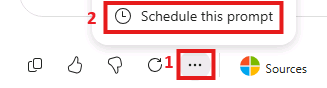
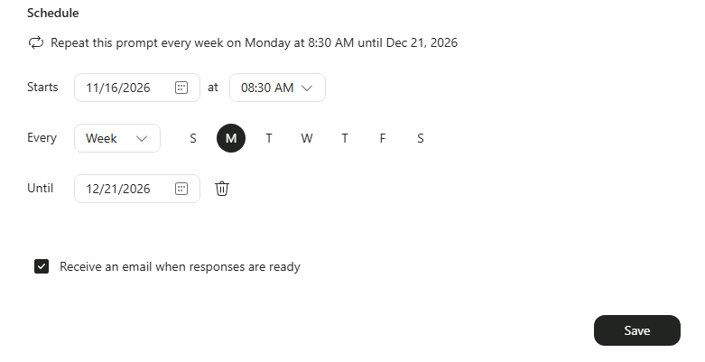

# Step 8: Engage with your agent

## Try your Morning Brief

Now that your agent is created, let's put it to work.

1. [ ] Go to **Suggested Prompts** and select **Morning Brief**.

1. [ ] Run the prompt and review your personalized Morning Brief. This is a prompt you can use each morning to help you start your day with focus and intention.

After you run the prompt:

1. [ ] Select the **three-dot menu (...)**.

1. [ ] Select **Schedule this prompt**.

   

1. [ ] Choose the **day and time** you want your agent to run the prompt.

   

Select **Next** to continue to the Workshop instructions.
